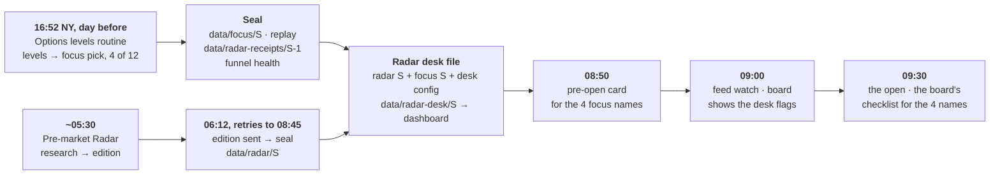

# trading-options-funnel

**Sealed evidence, replay and measurement for the trading lab's options selection funnel.**



The lab chooses what to trade in stages: the after-close focus pick (4 of the 12 desk names), the pre-market Radar,
and the board's checklist at the open. Each stage used to choose on its own, with no record of what it saw or left
out. This repository gives every stage a record:

- **Sealed evidence.** What each routine used or sent is kept byte for byte with its sha256, on the `data` branch,
  the same night, so it cannot change after the fact.
- **Replay.** Any sealed night can be re-run from the repository alone and must give the same answer.
- **Measurement.** Each stage can later be tested against the names it left out, under a record registered before
  any result is seen.

Research only. Nothing here places, previews or suggests an order. Paper trading is the only kind the lab runs.

## Status

| Stage | What runs | What this repository adds | Status |
|---|---|---|---|
| **Radar** | The pre-market research routine publishes an edition to the dashboard | `seal-radar`: the edition as sent, that morning's Nasdaq Trader symbol directory and the Radar skill's sha256 | Live since 2026-11-17 |
| **Focus names** | The after-close routine picks 4 of the 12 desk names (`focus.py pick`) | `seal-focus` and `replay-focus`: the picker's inputs and output, re-run by a port that must agree | Live since session 2026-11-18 (sealed the evening before) |
| **Radar desk file** | Built after the Radar seal, for the 12 desk names | `desk seal` and `desk send`: closed flag codes beside the board (Phase 1, display only) | Routine step live; first seal due for session 2026-11-18 |
| **Board** | The dashboard's checklist for the focus names | Shows the desk file's flags under the desk. It changes no pick, no board state and no rule | Live (release 2026-11-17) |
| **Receipts** | The dashboard keeps every radar copy with its receipt time | `seal-receipts`: that listing, sealed after each close | Live since 2026-11-17 |
| **Health** | `stocksdelta/funnel` on the dashboard | `funnel-health`: what was sealed and whether it replays | Live |

The Radar does not choose the focus names. Wiring it in is a strategy change. It needs its own hypothesis,
experiment and decision record in trading-lab-research first, and the Radar's forward evaluation (EXP-0038) to read.

## A night, step by step

Times are New York (the sessions' clock). Sydney is 16 hours ahead while New York is on standard time and Sydney
on summer time.

| New York | Routine (claude.ai) | Writes |
|---|---|---|
| 16:52 (day before) | **Options levels, after close.** Levels, focus pick, card, then the seal step | `data/focus/<S>`, `data/radar-receipts/<S-1>`, the funnel health document |
| ~05:30 | **Pre-market Radar.** Research, the six IBKR watch lists, the edition to the dashboard | The radar edition (dashboard) |
| 06:12, then every 20 min until 08:45 | **Radar edition to dashboard.** Confirms the edition is stored, then the seal step and the desk step | `data/radar/<S>`, `data/radar-desk/<S>`, the desk document |
| 08:50 | **Options focus, pre-open.** The card for the four names | (dashboard) |
| 09:00 | Dashboard feed watch expects the desk document; the board shows its flags | — |
| 09:30 | The open. Everything above must be sealed by now | — |

The exact routine steps are in [`docs/routine-steps.md`](docs/routine-steps.md). Each step runs only after the
routine's own work is done, reports only counts, paths and exit codes, and stops if a permission check blocks it.
The firing times (16:52, ~05:30, 06:12) are the routines' own schedules and 09:00 is the dashboard's feed watch;
this repository does not set them.

- The routines clone `main` as it is each night, so a merge to `main` changes the next night's run.
- The desk file is built only when that session's radar folder verifies, and its focus folder too if there is
  one (with no focus folder, the file is built with `focus` empty).
- The sends read `RADAR_INGEST_SECRET` and `VERCEL_AUTOMATION_BYPASS_SECRET` from the routine's environment and
  never print them.

## What is sealed

```
data branch (sealed evidence only; never edited, never force-pushed)
data/
  radar/<S>/          edition.json, MANIFEST.json, and nasdaqlisted.txt + otherlisted.txt when fetched
  radar-receipts/<S>/ listing.json, MANIFEST.json
  focus/<S>/          levels.json, iv_rows.csv, focus.json, MANIFEST.json
  radar-desk/<S>/     desk.json, earnings.csv, macro_events.csv, options_desk.yaml, MANIFEST.json
```

- Each `MANIFEST.json` holds the sha256 and size of every file, the time it was sealed, and its provenance: the
  routine, the code commit that sealed it and, for the Radar, the skill bundle's sha256.
- If the Nasdaq Trader directory cannot be fetched, the edition is still sealed without it, and EXP-0038 does not
  count that session.
- Re-sealing the same bytes does nothing. Different bytes go into a correction folder `<S>.rN` that names what it
  replaces. The first folder is never overwritten. Receipts are sealed once and never corrected.
- `<S>` is the New York session the files are for.

## Commands

Run from a checkout with `PYTHONPATH=src`. `--root` is a checkout of the `data` branch; `S` is a New York session
date. The full arguments of each command are in its `--help`.

```
# Seal one night's evidence
python -m options_funnel.cli seal-focus    --root R --levels L --iv-history IV --focus F [--correction]
python -m options_funnel.cli seal-radar    --root R --edition E --skill K (--fetch-directory | --directory D) [--correction]
python -m options_funnel.cli seal-receipts --root R --date S

# Check and replay
python -m options_funnel.cli verify FOLDER...          # radar, focus and receipts folders against their manifests
python -m options_funnel.cli replay-focus FOLDER...    # re-run the picker port on sealed nights, compare
python -m options_funnel.cli focus-pick LEVELS IV --candidates OUT   # score every desk name like the cloud picker

# The dashboard's health document
python -m options_funnel.cli funnel-health --root R --session S [--out F] [--send]

# The Radar desk file
python -m options_funnel.desk seal  --root R --session S --earnings E --macro M --desk-config Y [--wt-commit C]
python -m options_funnel.desk check --root R --session S      # rebuild and compare byte for byte
python -m options_funnel.desk send  --root R --session S [--dry-run]
python -m options_funnel.desk verify FOLDER...

# EXP-0038
python -m options_funnel.cli exp0038-status --root R --start S [--until D]   # counted sessions (counts only)
python -m options_funnel.cli exp0038-read ...                                # once, at the read date
```

Exit codes: 0 done (or already sealed identically) · 1 an output already exists · 3 bad input · 4 could not write ·
5 does not verify, replay or rebuild · 6 already sealed with different bytes · 7 not sent: refused, unreachable, or
the dashboard does not accept the document yet.

## The Radar desk file

One file per session for the 12 desk names. For each name it records whether it is a focus name, the Radar's lists
(as codes), grades and risk tag, the Radar's weekly levels beside the desk's own, and earnings and macro
events in the hold: from 09:30 New York on the session to 09:30 on the next session (for earnings: during or after
the close on the session, any day between, or before the open of the next session). It also sets closed flag codes:

`EARNINGS_BEFORE_OPEN` · `EARNINGS_IN_HOLD` · `EARNINGS_SOURCES_DISAGREE` · `MACRO_HIGH_IN_HOLD` ·
`RADAR_RISK_TAG` · `RADAR_NOT_COVERED` · `LEVELS_DISAGREE`

- The file holds no free text and no outcome of any kind.
- `earnings.csv` in trading-lab-research stays the board's source of earnings dates. The Radar's calendar is only a
  cross-check, and a disagreement is flagged, not resolved.
- The dashboard shows the flags for the focus names only (`stocksdelta/radar-desk` v1, pinned in
  [`contracts/`](contracts)).

## Guarantees

- **Paper only, no orders.** No code here talks to a broker.
- **Blind rule** (trading-lab-research DEC-0046 and DEC-0047). Nothing written or published here carries an outcome
  for a name that was not picked. `assert_blind` guards every document sent to the dashboard; the desk file and the
  candidate records also check their exact key sets.
- **Frozen analysis code.** EXP-0038's read runs only from a clean checkout of commit `eaff05f` (EXP-0038
  precondition 5), so later commits cannot change it. Since that commit no file under `src/`, `contracts/` or
  `tests/` that existed then has changed; only documentation has.
- **Pre-registration.** A strategy or evaluation change is registered in trading-lab-research before any result it
  affects is seen.
- **Secrets stay in the routines.** The routines hold the dashboard keys. This repository's CI runs with none.
  Only `exp0038-read` needs keys, once, at the read: the owner's Alpaca market-data keys and the dashboard keys.

## How it fits

| Piece | Where |
|---|---|
| Registered selection code, records (DEC, EXP, HYP), dashboard | [`Algorythmos-AI/trading-lab-research`](https://github.com/Algorythmos-AI/trading-lab-research), read at the commit in `wt.pin` |
| Focus card ledger (EXP-0032) | `Algorythmos-AI/trading-focus-card-ledger`, separate on purpose |
| Nightly jobs | claude.ai cloud routines; they seal what they send to this repository's `data` branch |
| This repository | sealing, verify and replay, the picker port, the desk file, the health document, EXP-0038's analysis code |

Why the boundary is drawn there: [`docs/adr/0001-repo-boundary.md`](docs/adr/0001-repo-boundary.md).

## Repository layout

```
src/options_funnel/   seal (and verify), replay, focus_pick (the picker port), candidates (its records);
                      desk; health and publish; witness (directory and receipts fetch); pin (the wt.pin tree);
                      exp0038* (frozen analysis); blind (the guard); calendar (pinned New York sessions)
scripts/              restricted-path guard, pre-push gate, wt-tree fetch, plan vector generator
tests/                pytest: synthetic inputs, generator vectors, parity with the picker
contracts/            dashboard schemas pinned by sha256, and the market calendar
docs/                 runbook, routine steps, Radar method audit, ADRs
radar/                sha256 manifest of the copied Radar skill files
wt.pin                the trading-lab-research commit read here
```

## Development

Needs Python 3.12, plus `uv`, `git`, `pre-commit` and `gitleaks` on PATH.

```
make bootstrap   # .venv from the hashed dev lock
make hooks       # pre-commit on commit, the full gate on push
make check       # ruff, mypy --strict, pytest, gitleaks: the same gate as CI
make wt-env      # only for code that imports trading-lab-research (see docs/runbook.md)
```

Pull requests go into `main` and are merged with a merge commit by the owner, once CI is green. Routines push only
to `data`. Contributor rules, data classes and the boundaries above are in [`AGENTS.md`](AGENTS.md). Running and
debugging: [`docs/runbook.md`](docs/runbook.md).

## Owner steps still open

- Record in EXP-0038's README that the repository is private (precondition 1; done on GitHub on 2026-11-18).
- Protect `data` with a ruleset: no deletion, no force push (EXP-0038 precondition 4).
- Require a pull request on `main` (its ruleset already blocks deletion and force push).
- Accept DEC-0055 in trading-lab-research.

EXP-0038's first counted session is the first regular session after the last of its preconditions is written in its
README.
